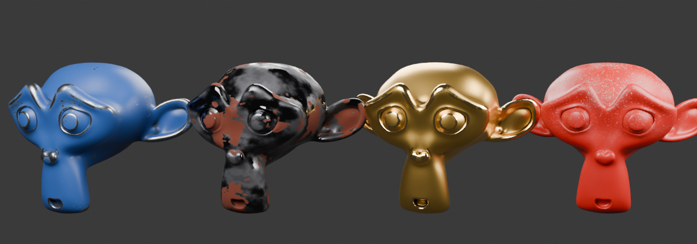
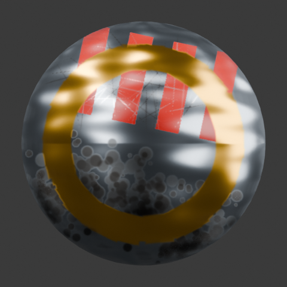
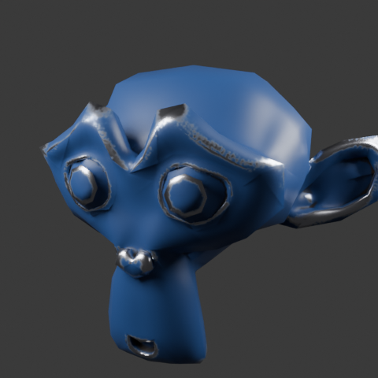
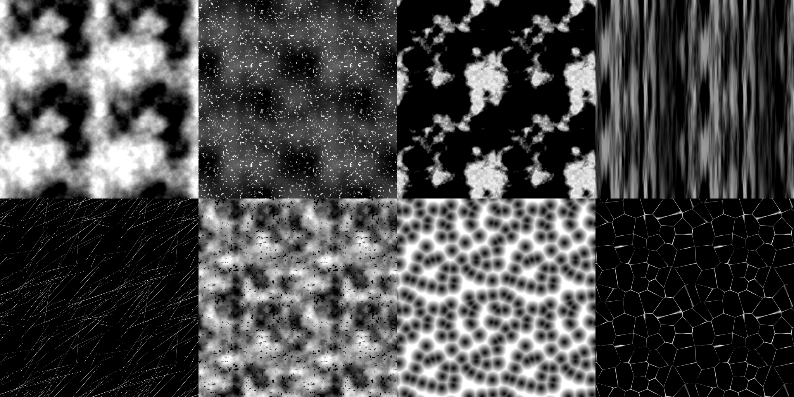

# PaintStack

Layered, multi-channel PBR texture painting for Blender, in the spirit of Substance 3D Painter.


*One stroke paints Base Color, Roughness, Metallic and Height together (gold swirl = metallic and raised, red = glossy and recessed).*



*Built-in smart materials (Painted Steel, Rusty Iron, Worn Gold, Dusty Plastic), each applied with one click. Every one adapts to its own mesh's baked curvature, AO and position.*



*Phase 3 brushes: stripes painted through a stencil, a Scratches tip, Dirt Splatter, a Square tip that follows the stroke, and a hammered-metal normal fill projected tri-planar (no UV seams).*



*Smart masks made by generators from baked maps: an Edge Wear generator on a metal fill layer and a Dirt generator on a grime fill layer, over a blue paint base. No hand painting.*

## Features (v0.5)

### Phase 5: performance
Measured with `tests/bench.py` on the same 4-core VM and the same scene: a smart-material folder with generator masks, a grunge fill, a painted layer and a top fill with a Dirt mask. Times are in milliseconds.

| | 1K v0.4 → v0.5 | 2K v0.4 → v0.5 | 4K v0.4 → v0.5 |
|---|---|---|---|
| Full composite | 461 → **181** | 2281 → **715** | 14239 → **3330** |
| Tweak a layer (opacity) | 391 → **89** | 2667 → **344** | 13798 → **1391** |
| Tweak a channel (colour) | 436 → **24** | 2668 → **85** | 14481 → **345** |
| Stroke start | 436 → **64** | 2965 → **420** | 12405 → **524** |
| Stroke update | 341 → **141** | 1603 → **511** | 9359 → **2192** |

Painting on a layer inside a folder was the slowest case in v0.4, at 5.7 s per 2K update. It now takes about 0.5 s.

How:
- **Region strokes**: the projector works out which texture regions each new dab can touch, from per-triangle screen and UV boxes clustered on a 64×64 grid. Only those regions are read back from the GPU, updated and recomposited. Cached full-resolution layers are sliced, not recomputed
- **Persistent compositor cache** per texture set, holding decoded pixels, layer entries and masks with a memory budget (set in the add-on preferences). Property edits invalidate only their own layer, and a channel colour edit invalidates only that channel, keeping the mask
- A **below-checkpoint** stores everything under the most recently edited root layer, so repeated tweaks re-blend only that layer and the ones above it
- **Cover culling** skips everything under an opaque, unmasked fill. **Sparse blending** blends masked layers only inside their mask's bounding box. Opaque folders composite in place, and blending is in place with no full-resolution temporaries
- Layer images are written **once per stroke** (not every update) and quantised to their 8-bit precision while painting, so live results, the cache and saved files match exactly
- `tests/test_phase5.py` checks that every cached, checkpointed, per-channel and region path produces the same result as a from-scratch composite


### Phase 4: smart assets
- **Smart materials**: 7 built-in (Painted Steel, Rusty Iron, Worn Gold, Dusty Plastic, Concrete, Chrome, Rubber). Each is applied as a folder above the active layer, and its generators re-bind to the target mesh's baked maps
- **Smart masks**: 7 built-in (Edge Wear, Dirt, Top Dust, Rust Spots, Leaks, Scratches, Cracks), appended to the active layer's mask stack
- **Save your own**: any layer or folder can be saved as a smart material, and any mask stack as a smart mask. Assets are saved as `.blend` files (painted pixels included) in a **PaintStack** library that is registered in Blender's **Asset Browser**
- **Grunge library**: 8 seamless procedural textures (Grunge, Dust, Rust Spots, Leaks, Scratches, Concrete, Cells, Cracks), usable as a **Grunge** mask generator (tri-planar when Position is baked), a fill texture, a stencil or a brush tip
- **Filter layers**: Blur, Sharpen, Hue/Saturation/Lightness and Warp. A filter applies to everything below it, per channel, with opacity and a mask
- **Anchor points**: tick a layer as an anchor, and an **Anchor** mask effect elsewhere can use that layer's result. For example, rust where you painted height. Painted strokes update the dependent layers live
- Fixes: duplicating a layer, or saving painted layers into an asset, no longer loses painted pixels (`Image.copy()` regenerates unsaved generated images)




### Phase 3: painter UX
- **Brush tips**: Round, Square, Splatter, Noise, Scratches, or any image. Tips can be set to an angle or follow the stroke
- **Dynamics**: size, angle and flow jitter, plus scatter, all seeded per stroke
- **Stencil**: a screen-space image that masks the brush. In paint mode, hold **S** and move to reposition it, scroll to scale it, and Ctrl+scroll to rotate it. It is drawn as an overlay in the viewport
- **Lazy mouse** for smooth lines, and **Shift+click** for a straight line from the end of the last stroke
- **Brush presets**: 7 built-in presets (Basic Hard and Soft, Square, Dirt Splatter, Cloudy, Scratches, Ink Line). Saving your own writes JSON files to Blender's config folder, so they are shared between .blend files
- **Normal channel**: paint or fill tangent-space normals with the **Normal Map Combine** (whiteout) blend mode. The baked high-poly normal is the base of the stack, and the height channel bumps on top
- **Fill-layer textures** on any channel, with **UV** tiling or seamless **tri-planar** projection from the baked Position and World Normal maps
- **Layer folders**: nested and collapsible, with their own opacity and mask stack (pass-through blending). Moving a layer up or down steps into and out of folders, and there are Group and Ungroup actions
- **Channel isolation view**: the **View** selector, or **C** in paint mode, cycles Material → each channel → Layer Mask, and **M** returns to the material
- The World Normal bake is now in the mesh's own space (it matches Position), which fixes tri-planar projection and curvature on rotated objects


### Phase 2: baking and smart masks
- **Mesh-map baker** (Cycles): Normal (high → low, cage extrusion and max ray distance), Ambient Occlusion, Curvature, Thickness, Position, World Normal, ID. Baking works from the low poly alone, or from a high-poly object onto the low poly
- **Curvature** combines Cycles pointiness with geometric curvature taken from the baked world-normal and position maps, so it picks up high-poly detail without seams at UV islands
- **Mask stack per layer**: Paint, Fill, generators and filters, each with a blend mode (Normal, Multiply, Add, Subtract, Max, Min), opacity and invert
- **Generators**: Edge Wear, Dirt, Curvature, Ambient Occlusion, Thickness, Position Gradient, 3D Noise. Noise is 3D value noise sampled at the baked positions, so it is seamless across UV seams
- **Filters**: Levels, Blur
- Painting on a mask that has generators automatically adds a **Paint** effect on top, so hand touch-ups work like in Substance
- The baked normal is wired into the material (it is combined with the painted height), and baked AO feeds Unreal ORM, the Unity MaskMap and glTF Occlusion on export
- Resolution option of 256 for quick look-dev
- **Color Selection** mask: click the model with the eyedropper to pick its baked ID colour, then adjust Tolerance. The ID source can be vertex colours, materials (well-separated colours) or mesh parts
- **Custom cage object** for high → low bakes
- **Non-blocking bake**: maps bake one at a time with progress in the status bar; Esc stops after the current map, and scene state is always restored
- **Fast generators**: noise runs on the GPU (same tables as the CPU fallback, so results match exactly), and noise and sources are cached separately from Level, Softness and Noise amount, so dragging those sliders is near-instant
- **Multiply AO** option darkens the material's base colour by the baked AO (viewport and render; exports are unaffected)

### Phase 1: core painting

- **Texture sets per material**: resolution 512–4K, with channels you switch on or off (Base Color, Metallic, Roughness, Height, Emission)
- **Layer stack**: paint layers and fill layers; add, duplicate, reorder, hide, and set opacity
- **Per-channel blend modes and opacity**: Normal, Multiply, Screen, Overlay, Soft Light, Add, Subtract, Darken, Lighten, Difference
- **Layer masks**: paint black or white to hide or reveal. Painting on a fill layer automatically gives it a mask (fill plus black mask, then paint to reveal)
- **GPU projection painting**: the brush is projected from the screen into UV space, with occlusion (depth prepass), back-face rejection, a grazing-angle fade, and seam bleeding across UV island borders
- **Brush**: radius, hardness, flow, stroke opacity, spacing, tablet pressure, X-mirror symmetry, paint/erase
- **Stroke undo and redo**
- **Fast material**: the stack is flattened into one map per channel, so the shader stays small no matter how many layers there are
- **Export presets**: Blender/Generic, Unreal (ORM, DirectX normal), Unity (MaskMap), glTF (MetallicRoughness), with edge padding

## Install

Blender 4.2 or newer (tested with 5.2).

```bash
./build.sh            # creates dist/paintstack-0.1.0.zip
```

In Blender, go to **Edit → Preferences → Get Extensions → ⌄ → Install from Disk…** and choose the zip.

## Use

1. Select a mesh **that has a UV map** and open the **N-panel → PaintStack** tab.
2. Click **Create Texture Set**. This creates a "Base Material" fill layer and a "Paint 1" layer.
3. Switch the viewport to **Material Preview**.
4. Under **Brush**, choose the channels to paint and their values, then click **Start Painting**.
5. For smart materials and masks, open **Bake Mesh Maps**, optionally set a **High Poly** object, and click **Bake**. Then add a fill layer and use **+** in its mask stack to add **Edge Wear**, **Dirt** and other generators, or pick one from **Smart Assets → Smart Material / Smart Mask**.

| Key (in paint mode) | Action |
|---|---|
| LMB drag | Paint |
| Shift+LMB | Straight line from the end of the last stroke |
| S + move / wheel / Ctrl+wheel | Move / scale / rotate the stencil |
| C / M | Cycle channel views / back to the material |
| `[` / `]` | Brush radius |
| `X` | Toggle paint / erase |
| Ctrl+Z / Ctrl+Shift+Z | Undo / redo stroke |
| MMB, wheel, etc. | Navigate as usual |
| Esc | Exit paint mode |

Generated images are packed into the .blend automatically when you save.

## Architecture

```
paintstack/
  props.py          data model: Material.paintstack → layers → per-channel settings
  channels.py       PBR channel definitions
  compositor.py     numpy layer compositor (stack → output map per channel)
  material.py       Principled BSDF wiring (touches only PS_* nodes)
  stack.py          layer folders: contiguous blocks in the flat list, tree, moves
  brushes.py        brush tips and the preset library
  fills.py          fill-layer textures: UV tiling and tri-planar projection
  grunge.py         seamless procedural grunge library
  filters.py        filter layers: blur, sharpen, HSL, warp
  smart.py          smart materials / masks: built-in recipes, .blend asset library
  masks.py          mask stack evaluation (paint / fill / generators / levels / blur)
  generators.py     edge wear, dirt, curvature, AO, thickness, position, 3D noise
  baker.py          Cycles mesh-map baker (stepwise BakeJob, modal operator)
  picking.py        eyedropper: ray -> UV -> baked ID colour
  engine/noise_gpu.py  GLSL fBm noise for generators
  engine/shaders.py GLSL: depth prepass, UV-space brush dab, UV coverage
  engine/projector.py  mesh → GPU batches, stroke-mask accumulation
  stroke.py         dab spacing, mirror, applying the stroke mask to all target channels
  paint_mode.py     modal viewport operator, brush cursor
  undo.py           stroke undo/redo stack
  export.py         engine presets, channel packing, normal from height, padding
  ui.py             sidebar panels
```

A stroke renders brush dabs into a single **stroke mask** in UV space on the GPU. On the CPU, that mask is then used to write every target channel image of the active layer. During a stroke, the layers below the active one are flattened once and cached, so each live update only re-blends the active layer and the layers above it.

## Tests

The tests run headless using Blender as a Python module, with a software OpenGL driver (Mesa llvmpipe):

```bash
pip install bpy numpy          # bpy wheel must match your Python version
# Debian/Ubuntu: apt install libegl1 libegl-mesa0 libgl1-mesa-dri
python tests/test_headless.py  # Phase 1: compositing, projection, occlusion, undo, masks, export, save/load
python tests/test_phase2.py    # Phase 2: high->low bake, every map, generators, mask stack, AO in export
python tests/test_phase2_extras.py  # ID by material, ray pick + colour selection, cage, cancelled jobs, GPU noise
python tests/test_phase3.py    # tips, rotation, stencil, jitter, lazy, lines, presets, normals, fills, folders, views
python tests/demo_phase3.py docs/phase3.png
python tests/test_phase4.py    # grunge, filters, anchors, built-in + saved smart materials / masks
python tests/demo_phase4.py docs/smart_materials.png
python tests/demo_grunge.py docs/grunge.png
python tests/test_phase5.py    # caches / checkpoints / regions == from-scratch composite
python tests/bench.py 1024 2048 4096   # timings
python tests/demo_render.py docs/demo.png
python tests/demo_bake.py docs/  # bakes.png contact sheet + generators.png render
```

See [docs/ROADMAP.md](docs/ROADMAP.md) for what comes next.
