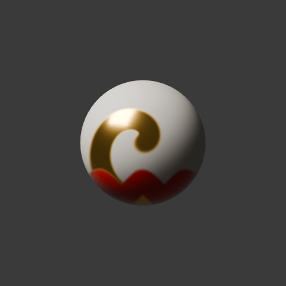

# PaintStack

Layered, multi-channel PBR texture painting for Blender, in the spirit of Substance 3D Painter.



*One stroke paints Base Color, Roughness, Metallic and Height together (gold swirl = metallic and raised, red = glossy and recessed).*

## Features (v0.1, Phase 1 MVP)

- **Texture sets per material**: resolution 512–4K, with channels you switch on or off (Base Color, Metallic, Roughness, Height, Emission)
- **Layer stack**: paint layers and fill layers; add, duplicate, reorder, hide, and set opacity
- **Per-channel blend modes and opacity**: Normal, Multiply, Screen, Overlay, Soft Light, Add, Subtract, Darken, Lighten, Difference
- **Layer masks**: paint black or white to hide or reveal. Painting on a fill layer automatically gives it a mask (fill plus black mask, then paint to reveal)
- **GPU projection painting**: the brush is projected from the screen into UV space, with occlusion (depth prepass), back-face rejection, a grazing-angle fade, and seam bleeding across UV island borders
- **Brush**: radius, hardness, flow, stroke opacity, spacing, tablet pressure, X-mirror symmetry, paint/erase
- **Stroke undo and redo**
- **Fast material**: the stack is flattened into one map per channel, so the shader stays small no matter how many layers there are
- **Export presets**: Blender/Generic, Unreal (ORM, DirectX normal), Unity (MaskMap), glTF (MetallicRoughness), with edge padding

## Install

Blender 4.2 or newer (tested with 5.2).

```bash
./build.sh            # creates dist/paintstack-0.1.0.zip
```

In Blender, go to **Edit → Preferences → Get Extensions → ⌄ → Install from Disk…** and choose the zip.

## Use

1. Select a mesh **that has a UV map** and open the **N-panel → PaintStack** tab.
2. Click **Create Texture Set**. This creates a "Base Material" fill layer and a "Paint 1" layer.
3. Switch the viewport to **Material Preview**.
4. Under **Brush**, choose the channels to paint and their values, then click **Start Painting**.

| Key (in paint mode) | Action |
|---|---|
| LMB drag | Paint |
| `[` / `]` | Brush radius |
| `X` | Toggle paint / erase |
| Ctrl+Z / Ctrl+Shift+Z | Undo / redo stroke |
| MMB, wheel, etc. | Navigate as usual |
| Esc | Exit paint mode |

Generated images are packed into the .blend automatically when you save.

## Architecture

```
paintstack/
  props.py          data model: Material.paintstack → layers → per-channel settings
  channels.py       PBR channel definitions
  compositor.py     numpy layer compositor (stack → output map per channel)
  material.py       Principled BSDF wiring (touches only PS_* nodes)
  engine/shaders.py GLSL: depth prepass, UV-space brush dab, UV coverage
  engine/projector.py  mesh → GPU batches, stroke-mask accumulation
  stroke.py         dab spacing, mirror, applying the stroke mask to all target channels
  paint_mode.py     modal viewport operator, brush cursor
  undo.py           stroke undo/redo stack
  export.py         engine presets, channel packing, normal from height, padding
  ui.py             sidebar panels
```

A stroke renders brush dabs into a single **stroke mask** in UV space on the GPU. On the CPU, that mask is then used to write every target channel image of the active layer. During a stroke, the layers below the active one are flattened once and cached, so each live update only re-blends the active layer and the layers above it.

## Tests

The tests run headless using Blender as a Python module, with a software OpenGL driver (Mesa llvmpipe):

```bash
pip install bpy numpy          # bpy wheel must match your Python version
# Debian/Ubuntu: apt install libegl1 libegl-mesa0 libgl1-mesa-dri
python tests/test_headless.py  # 25 checks: compositing, projection, occlusion, undo, masks, export, save/load
python tests/demo_render.py docs/demo.png
```

See [docs/ROADMAP.md](docs/ROADMAP.md) for what comes next.
